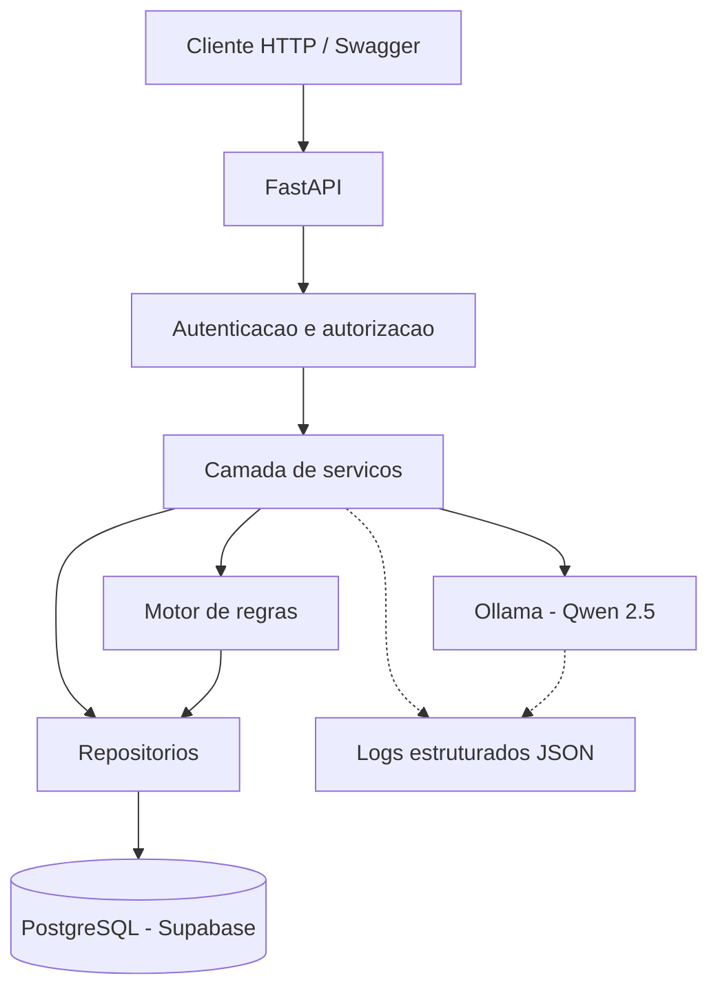

# AI Corporate Assistant

Assistente corporativo de classificação de chamados desenvolvido com Python, FastAPI, Ollama e PostgreSQL.

## Objetivo

Construir uma API capaz de apoiar a triagem de chamados corporativos utilizando inteligência artificial, regras de negócio e mecanismos de segurança.

O projeto foi desenvolvido com foco em engenharia de IA, qualidade de software e arquitetura de aplicações.

## Funcionalidades

- Cadastro e consulta de chamados.
- Classificação de chamados com modelo de linguagem local.
- Categorias: suporte, financeiro e comercial.
- Validação das respostas produzidas pela IA.
- Avaliação de prioridade por regras determinísticas.
- Encaminhamento para revisão humana quando necessário.
- Histórico de auditoria das alterações de prioridade.
- Autenticação por tokens Bearer.
- Controle de acesso por perfil: administrador e analista.
- Logs estruturados em JSON.
- Monitoramento do tempo de execução da classificação.
- Tratamento de erros e testes de resiliência.

## Tecnologias

- Python
- FastAPI
- Pydantic
- SQLAlchemy
- PostgreSQL (Supabase)
- Ollama — modelo Qwen 2.5 1.5B
- Pytest
- Requests

## Arquitetura

A aplicação está organizada em camadas:

- `core/`: configuração do banco, segurança e monitoramento.
- `schemas/`: validação de dados com Pydantic.
- `models/`: modelos de persistência.
- `repositories/`: acesso ao banco de dados.
- `services/`: lógica de negócio e integração com IA.
- `tests/`: testes automatizados.
- `evals/`: avaliação de classificações e comparação de prompts.
- `prompts/`: versões dos prompts utilizados.

## Segurança

A API utiliza autenticação por token Bearer e controle de permissões por perfil.

Administradores podem avaliar prioridades e consultar auditorias. Analistas podem cadastrar, consultar e classificar chamados.

Os tokens são configurados por variáveis de ambiente e não devem ser publicados no repositório.

## Qualidade e testes

A suíte de testes utiliza Pytest e cobre:

- Operações da API.
- Integração com banco de dados de teste.
- Classificação e validação de respostas da IA.
- Autenticação e autorização.
- Auditoria de alterações.
- Monitoramento e logs.
- Falhas de comunicação, timeout e recuperação.

## Limitações conhecidas

- O modelo de IA é executado localmente.
- O desempenho depende dos recursos da máquina.
- A autenticação por tokens representa perfis de acesso, não contas individuais.
- O projeto ainda não possui uma interface web própria.
- Os testes automatizados não substituem avaliações com dados reais de produção.

## Finalidade

Projeto educacional e de portfólio voltado ao desenvolvimento de competências em Engenharia de IA, integração de LLMs, APIs, bancos de dados, testes e observabilidade.


## Diagrama de arquitetura



## Demonstração da API

A aplicação oferece documentação interativa pelo Swagger:

http://127.0.0.1:8000/docs

### 1. Cadastrar um chamado

**Endpoint:** `POST /chamados`

Requer autenticação Bearer com perfil `admin` ou `analyst`.

Requisição:

```json
{
  "descricao": "Não consigo acessar meu e-mail corporativo."
}
```

Resposta ilustrativa:

```json
{
  "id": 1,
  "descricao": "Não consigo acessar meu e-mail corporativo.",
  "categoria": null,
  "prioridade": null,
  "status": "aberto",
  "criado_em": "2026-11-09T10:00:00"
}
```

### 2. Classificar com IA

**Endpoint:** `POST /chamados/1/classificar`

Requer autenticação Bearer.

A API utiliza um modelo Qwen 2.5 executado localmente pelo Ollama para classificar o chamado.

Exemplo de resposta ilustrativa:

```json
{
  "id": 1,
  "descricao": "Não consigo acessar meu e-mail corporativo.",
  "categoria": "suporte",
  "prioridade": null,
  "status": "revisao",
  "criado_em": "2026-11-09T10:00:00"
}
```

A IA sugere a categoria, mas não define diretamente a prioridade persistida.

### 3. Avaliar prioridade

**Endpoint:** `POST /chamados/1/avaliar-prioridade`

Requer perfil `admin`.

Requisição:

```json
{
  "impacto": "critico",
  "bloqueia_trabalho": true,
  "solicitacao_rotineira": false
}
```

Resposta ilustrativa:

```json
{
  "prioridade": "alta",
  "revisao_humana": false,
  "motivo": "Impacto crítico"
}
```

A prioridade é definida pelo motor de regras, e suas alterações são registradas no histórico de auditoria.
```
